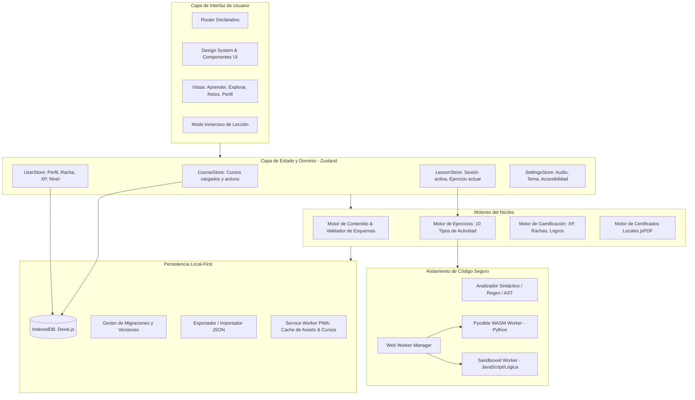

# Nodu — Arquitectura Técnica Escalable (ARCHITECTURE)

> **Documento vivo de arquitectura de software** | Versión: 0.4.0 (Fase 4 — Arquitectura Técnica)  
> **Estado:** Propuesta formal para revisión y aprobación

---

## 1. Principios de Arquitectura Técnica

1. **Local-First por Diseño (Cero Backend Obligatorio):**
   - El estado del usuario, progreso, configuraciones, notas y certificados se persisten de forma síncrona en el almacenamiento estructurado del navegador (`IndexedDB` vía `Dexie.js`).
   - La aplicación funciona al 100% sin conexión a internet desde el primer segundo tras la instalación de la PWA.
2. **Arquitectura Data-Driven (Separación Estricta Código vs. Contenido):**
   - El motor de Nodu no conoce "Python", "SQL" o "JavaScript" como código acoplado; solo interpreta esquemas de curso validados tipados (`CourseSchema`).
   - Añadir un nuevo curso consiste exclusivamente en incorporar su archivo de definición y sus recursos estáticos.
3. **Ejecución de Código Aislada y Segura (Sandboxed Client-Side Execution):**
   - El código suministrado por el usuario **nunca** se evalúa en el hilo principal del DOM (`window`).
   - Para ejercicios de sintaxis ligera: validación estática de AST / analizador léxico.
   - Para ejercicios ejecutables reales: ejecución en segundo plano mediante `Web Workers` dedicados y entornos seguros como `Pyodide` (Python WASM) o un sandbox aislado de JavaScript.
4. **Cero Dependencias Infladas (Ultra-Fast & Lightweight):**
   - Se eligen herramientas compiladas y minimalistas. Tamaño del bundle base inicial $< 180KB$ gzipped (sin contar runtimes WASM diferidos).

---

## 2. Comparativa y Selección de Tecnologías

| Necesidad | Opciones Evaluadas | Opción Seleccionada | Justificación Técnica |
| :--- | :--- | :--- | :--- |
| **Framework / Bundler** | Next.js vs. Vite + React | **Vite + React (SPA / PWA)** | Next.js introduce complejidad de SSR/Node que contradice la filosofía 100% estática y offline-first. Vite genera un bundle estático óptimo, con recarga instantánea HMR y despliegue trivial en cualquier CDN o almacenamiento local sin servidor. |
| **Tipado** | JavaScript vs. TypeScript | **TypeScript (Strict Mode)** | Imprescindible para garantizar la integridad de los esquemas de cursos, validadores de ejercicios y tipos de datos del progreso. |
| **Persistencia Local** | LocalStorage vs. SQLite WASM vs. Dexie.js (IndexedDB) | **Dexie.js (IndexedDB)** | `LocalStorage` es síncrono, bloquea el hilo principal y tiene límite de 5MB. `SQLite WASM` añade sobrecarga de 1MB+. `Dexie.js` ofrece API reactiva, tipada, asíncrona, con soporte nativo de índices, transacciones y migraciones de esquema sin penalización de peso (~20KB). |
| **Gestión de Estado** | Redux vs. Zustand | **Zustand** | Huella ultraligera (~1KB), sin boilerplate innecesario, fácil integración con persistencia y selectores reactivos atómicos para un rendimiento impecable a 60fps. |
| **PWA & Offline Cache** | Workbox / Vite PWA Plugin | **vite-plugin-pwa (Service Workers con Workbox)** | Caché automática de assets estáticos (HTML/JS/CSS/Fonts) y estrategia *CacheFirst* para los paquetes de cursos y certificados. |
| **Editor de Código** | Monaco Editor vs. CodeMirror 6 vs. Mini-Editor Propio | **Arquitectura Híbrida:**<br>1. *Mini-Editor Propio con Sintaxis Sintética* para ejercicios móviles.<br>2. *CodeMirror 6* modular para proyectos avanzados. | Monaco Editor pesa más de 5MB gzipped y su soporte táctil móvil es deficiente. CodeMirror 6 es moderno, modular (~150KB), accesible y con excelente soporte táctil. Para lecciones rápidas de 5 minutos, el mini-editor de bloques con botones rápidos tiene cero latencia. |
| **Generación de Certificados** | Canvas a Imagen vs. jsPDF | **jsPDF** | Permite generar documentos PDF vectoriales en cliente con tipografías embebidas, tamaño de archivo mínimo ($< 100KB$) y alta resolución imprimible, sin recurrir a APIs de servidor. |
| **Ejecución de Python** | API Externa vs. Pyodide (WASM) / Skulpt | **Pyodide en Web Worker con carga perezosa** | Cero costo de servidor, total privacidad, soporta la librería estándar de Python. Se desacopla en un Worker para no congelar la UI y se descarga bajo demanda únicamente al llegar a la unidad práctica. |

---

## 3. Diagrama de Arquitectura Modular



---

## 4. Esquema de Base de Datos Local (IndexedDB / Dexie)

El almacenamiento se organiza en almacenes (*stores*) tipados e indexados:

```typescript
// Esquema de tablas Dexie
interface NoduDatabaseSchema {
  // 1. Perfil y Preferencias
  profile: {
    id: string; // 'current_user'
    name: string;
    avatarId: string;
    dailyGoalMinutes: number;
    streakDays: number;
    lastActiveDate: string; // YYYY-MM-DD
    totalXp: number;
    currentLevel: number;
    gems: number;
    streakFreezeAvailable: number;
    createdAt: number;
  };

  // 2. Progreso por Curso
  courseProgress: {
    courseId: string; // Primaria
    status: 'not_started' | 'in_progress' | 'completed';
    activeUnitId: string;
    activeLessonId: string;
    completedLessons: string[]; // ['py-u1-l1', 'py-u1-l2']
    unlockedUnits: string[];    // ['py-u1', 'py-u2']
    examScores: Record<string, number>; // { 'py-u1-exam': 95 }
    projectCompleted: boolean;
    percentComplete: number;
    updatedAt: number;
  };

  // 3. Historial de Actividad (Para gráficos de constancia)
  activityLog: {
    id?: number; // Autoincremental
    date: string; // YYYY-MM-DD (Indexado)
    xpGained: number;
    lessonsCompleted: number;
    minutesSpent: number;
  };

  // 4. Logros Desbloqueados
  achievements: {
    id: string; // Primaria (ej. 'first_lesson', 'streak_7')
    unlockedAt: number;
    progress: number; // 0 a 100
    claimed: boolean;
  };

  // 5. Certificados Emitidos
  certificates: {
    id: string; // Primaria (UUID / Hash SHA-256)
    courseId: string;
    courseTitle: string;
    recipientName: string;
    issueDate: string;
    finalScore: number;
    verificationHash: string;
  };
}
```

---

## 5. Estrategia de Versionado y Migración de Datos

1. **Versionado Semántico en DB:** Cada cambio de estructura en Dexie declara una versión (`db.version(2).stores(...)`) con funciones de actualización automáticas para evitar pérdidas de progreso en actualizaciones de la app.
2. **Copia de Seguridad Integral (JSON Backup):**
   - Una función pura extrae todas las tablas de IndexedDB y genera un archivo descargable con formato `nodu-backup-[fecha].json`.
   - El importador valida la firma del JSON, comprueba la compatibilidad de esquema y restaura de forma transaccional (si algo falla, revierte sin tocar los datos previos).
