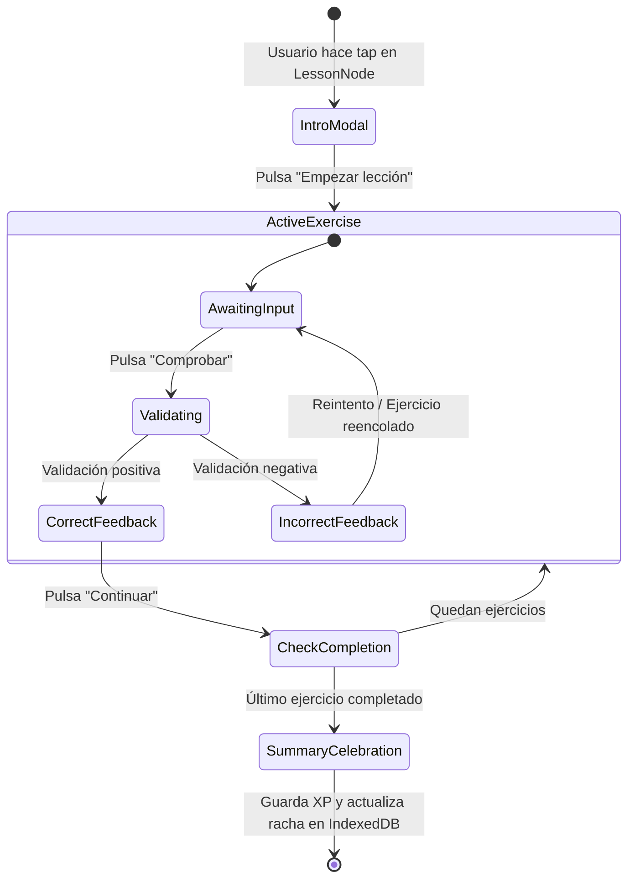

# Nodu — Motor de Aprendizaje y Validación (LEARNING_ENGINE)

> **Documento vivo de arquitectura pedagógica** | Versión: 0.5.0 (Fase 5 — Motor de Aprendizaje)  
> **Estado:** Propuesta formal para revisión y aprobación

---

## 1. Misión del Motor de Aprendizaje

El motor de aprendizaje de **Nodu** es el corazón interactivo de la plataforma. Su responsabilidad es interpretar el `CourseSchema`, gestionar la sesión activa de lección, evaluar las respuestas del alumno con rigor pedagógico y emitir retroalimentación formativa inmediata sin recurrir a servidores remotos.

---

## 2. Los 10 Validadores Especializados de Ejercicios

Cada tipo de ejercicio cuenta con su propio validador determinista:

| Tipo de Ejercicio | Entrada del Usuario | Lógica de Validación | Feedback Específico |
| :--- | :--- | :--- | :--- |
| **1. multiple_choice** | ID de la opción elegida | Comprobación de flag `isCorrect`. | Justificación pedagógica de por qué esa opción es correcta y por qué los distractores fallan. |
| **2. true_false** | Booleano (`true`/`false`) | Coincidencia estricta de verdad lógica. | Explicación del fundamento sintáctico o semántico. |
| **3. fill_blank** | Token(s) insertado(s) | Normalización de espacios y cotejo contra lista de respuestas válidas (`acceptableAnswers`). | Pista contextual de caracteres esperados (ej. `:` al final de un `def`). |
| **4. parsons_order** | Array ordenado de IDs de bloque e indentación | Verificación de orden secuencial y profundidad de tabulación esperada. | Identificación precisa del primer bloque mal ubicado o mal indentado. |
| **5. spot_bug** | Índice de línea pulsada | Comprobación contra `buggyLineIndex`. | Resalta la línea y explica qué regla del lenguaje viola (ej. "Falta cerrar comillas"). |
| **6. predict_output** | Opción de salida seleccionada | Coincidencia contra el valor devuelto por la ejecución real o simulada. | Muestra el rastreo mental paso a paso de la memoria de las variables. |
| **7. match_pairs** | Mapa de conexiones realizadas | Coincidencia bidireccional de todos los pares. | Confirma los aciertos y permite reintentar sólo los pares discordantes. |
| **8. code_runner** | Código escrito por el usuario | Ejecución en Web Worker contra batería de tests unitarios (casos públicos y secretos). | Detalle de caso fallido: `Entrada: X`, `Esperado: Y`, `Obtenido: Z`. |
| **9. code_repair** | Código corregido por el usuario | Análisis de diff léxico y ejecución de tests de verificación. | Mensaje de éxito al eliminar el error sin alterar la funcionalidad esperada. |
| **10. logic_puzzle** | Secuencia de acciones o deducción | Validación del estado final del autómata o resultado matemático. | Desglose del algoritmo óptimo vs. subóptimo. |

---

## 3. Máquina de Estados de una Lección Inmersiva

---

## 4. Gestión del Error y Re-encolado Inteligente

- Si el estudiante comete un error, el ejercicio **no se pierde**:
  1. Se muestra el panel didáctico de corrección con la explicación de por qué falló.
  2. El ejercicio se coloca al final de la cola de la lección actual.
  3. La lección sólo termina cuando todos los conceptos han sido superados con éxito.
  4. La precisión final determina el cálculo de bonificación de XP ($100\%$ aciertos a la primera = $+5$ XP extra "Perfect Lesson").
