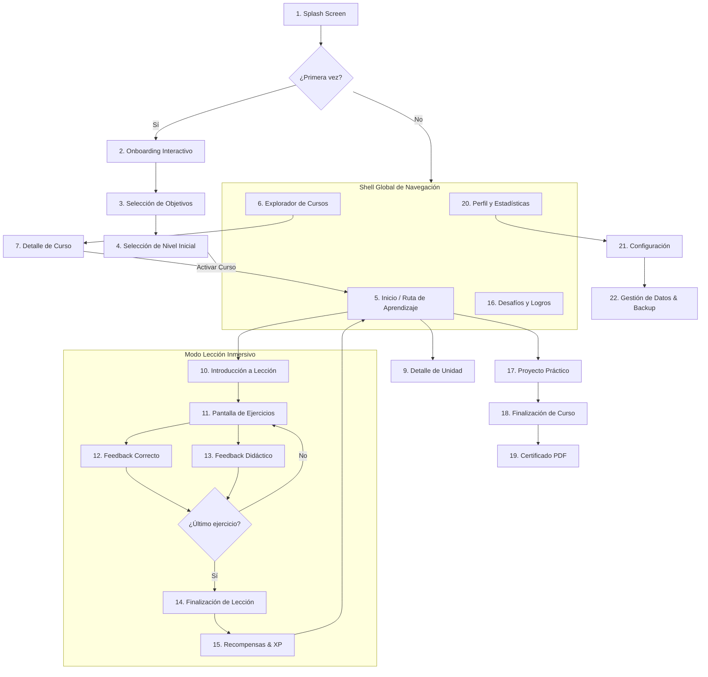

# Nodu — Guía y Principios de Experiencia de Usuario (UX_GUIDELINES)

> **Documento vivo de diseño de experiencia** | Versión: 0.2.0 (Fase 2 — Arquitectura UX)  
> **Estado:** Propuesta formal para revisión y aprobación

---

## 1. Principios Rectores de UX para Nodu

1. **Micro-interacciones sin fricción (Bucle de 5 minutos):**
   - Una lección nunca debe exceder los 3 a 7 minutos de duración media.
   - Tiempo de carga percibido entre pantallas: `< 100ms`.
   - Cero formularios o barreras previas: el usuario puede comenzar su primera lección a los 10 segundos de abrir la app por primera vez.

2. **Pedagogía del Error Positivo (No-Punitive Feedback):**
   - El error no es un fracaso, es depuración (*debugging*).
   - Cuando el usuario se equivoca, la respuesta incorrecta se acompaña inmediatamente de una explicación pedagógica de **por qué** falló y una pista constructiva.
   - No hay bloqueo por vidas o corazones agotados. El alumno siempre puede completar la lección.

3. **Ergonomía Móvil para Programación (Touch-First Code UX):**
   - Escribir sintaxis en un teclado virtual suele ser frustrante. Nodu prioriza:
     - Bloques de código seleccionables con un solo toque (*tap-to-slot*).
     - Barra de accesorios rápidos sobre el teclado (`()`, `[]`, `{}`, `:`, `"`, `=`, `Tab`).
     - Indentación automática inteligente.

4. **Claridad Espacial en el Aprendizaje (El Camino de Nodos):**
   - El estudiante siempre sabe:
     - Dónde está exactamente hoy.
     - Qué acaba de dominar.
     - Cuál es el siguiente paso lógico.
     - Qué recompensa o proyecto le espera al final de la unidad.

---

## 2. Mapa Completo de Navegación y Jerarquía

La navegación se estructura en dos niveles:
- **Nivel Global (Shell de la Aplicación):** Barra inferior permanente en móviles (Bottom Nav) y barra lateral fija en escritorio (Sidebar).
- **Nivel Contextual (Modo Inmersivo):** Pantallas a pantalla completa sin distracciones para Lecciones, Evaluaciones y Proyectos.



---

## 3. Especificación Detallada de las 22 Pantallas

A continuación se definen los objetivos, anatomía visual y estados de cada una de las pantallas del sistema:

### Bloque A: Entrada y Onboarding
1. **Splash Screen:** Carga ultrarrápida, logo de Nodu animado con pulso suave, verificación de base de datos local IndexedDB y estado de onboarding.
2. **Onboarding:** Carrusel de 3 diapositivas explicativas (Aprende con práctica real $\rightarrow$ Ejecuta código localmente $\rightarrow$ Domina tu ritmo diario).
3. **Selección de Objetivos:** Elección del compromiso diario (Casual: 5 min/día, Regular: 10 min/día, Intensivo: 20 min/día) y meta personal (conseguir empleo, afición, apoyo a estudios).
4. **Selección de Nivel Inicial:** Selector bifurcado: "¿Nunca has programado?" (arranca desde el nodo 1) vs "¿Ya conoces las bases?" (ofrece un test de nivel rápido para desbloquear unidades iniciales).

### Bloque B: Navegación Principal y Exploración
5. **Inicio (El Camino de Nodos):**
   - *Cabecera:* Selector del curso actual, indicador de racha activa (con icono de fuego/energía), contador de gemas y XP del día.
   - *Cuerpo:* Ruta vertical serpenteante de nodos circulares interactivos con estados: `Completado` (con estrella dorada), `Activo` (pulsante con anillo de progreso), `Bloqueado` (candado tenue).
   - *Puntos de control:* Hitos de examen y proyectos finales destacados con cajas de unidad temáticas.
6. **Explorador de Cursos:** Catálogo con filtros por categoría (Backend, Frontend, Datos, Fundamentos). Tarjetas con título, icono de tecnología, dificultad, duración estimada y botón "Empezar" o "Continuar".
7. **Detalle de Curso:** Vista completa del plan de estudios: resumen, prerrequisitos, lista de unidades temáticas con sus lecciones asociadas, y botón de acción principal ("Fijar como curso principal").
8. **Mapa de Aprendizaje Extendido:** Vista panorámica tipo árbol o sitemap para ver todo el progreso global de la carrera tecnológica seleccionada.
9. **Detalle de Unidad:** Modal o pantalla deslizable (*bottom sheet*) con los objetivos pedagógicos de la unidad, lecciones incluidas y estado del proyecto final.

### Bloque C: Motor de Lección y Ejercicios
10. **Introducción a Lección:** Tarjeta sintética con el concepto clave que se va a aprender en la sesión, con un fragmento de código resaltado y una analogía del mundo real.
11. **Pantalla de Ejercicios:**
    - Barra de progreso superior continua (ej. 3/8 completados).
    - Botón de salir seguro (guarda el progreso parcial).
    - Enunciado claro y contextualizado.
    - Área de interacción dinámica según el tipo de ejercicio (bloques ordenables, opciones múltiples, editor con mini-teclado de sintaxis).
    - Botón primario inferior fijo "Comprobar".
12. **Feedback de Respuesta Correcta:** Panel emergente inferior verde/turquesa vibrante con sonido sutil de confirmación, explicación adicional si aporta contexto y botón "Continuar".
13. **Feedback de Respuesta Incorrecta:** Panel emergente inferior ámbar/coral respetuoso. Muestra la solución correcta explicada paso a paso, la pista de por qué falló y botón "Entendido" para volver a intentarlo al final de la lección.
14. **Pantalla de Finalización de Lección:** Celebración visual, gráfico radial de precisión (% de aciertos al primer intento) y tiempo invertido.
15. **Recompensas y Experiencia (XP):** Animación de conteo de XP obtenido (+15 XP base, +5 XP bono de racha), avance en la barra de nivel y actualización del calendario de racha diaria.

### Bloque D: Evaluaciones y Proyectos
16. **Evaluaciones de Hito:** Formato de evaluación sin pistas intermedias para consolidar el paso de una unidad a otra. Requiere un 80% de aciertos para desbloquear el siguiente bloque.
17. **Proyectos Prácticos:** Editor de código interactivo a pantalla dividida con mini-consola de salida, especificaciones del proyecto en pestañas y botón de verificación de tests unitarios locales.
18. **Pantalla de Finalización de Curso:** Gran hito visual con trofeo de tecnología completada, estadísticas acumuladas del curso y botón para emitir el certificado.
19. **Certificados Locales:** Visualización del certificado generado con datos locales (Nombre, tecnología, fecha, hash criptográfico de integridad) y acciones para Guardar PDF o Compartir imagen.

### Bloque E: Perfil, Logros y Ajustes
20. **Perfil y Estadísticas:** Gráfica de constancia semanal/mensual, total de XP, días de racha máxima, insignias desbloqueadas y lista de certificados obtenidos.
21. **Configuración:** Preferencias de accesibilidad (tamaño de fuente, contraste alto, reducción de movimiento), sonido, recordatorios locales y tema visual.
22. **Gestión de Datos y Copias de Seguridad:** Espacio ocupado en IndexedDB, botón "Exportar copia de seguridad (JSON)", botón "Restaurar copia de seguridad" y opción segura de "Restablecer datos locales".

---

## 4. User Journey: El Flujo Diario del Alumno

```
[ Abre Nodu ] 
      │ (0 clics)
      ▼
[ Ve su Racha Activa y el Nodo Actual ]
      │ (1 clic en el nodo pulsante)
      ▼
[ Micro-Explicación (15-30s) ]
      │ (1 clic en "Empezar")
      ▼
[ Resuelve 5-7 Ejercicios Rápidos ]
      │ (Feedback inmediato en cada paso)
      ▼
[ Pantalla de Éxito + XP + Racha Asegurada ]
      │ (Duración total: ~4 minutos)
      ▼
[ Sensación de logro y cierre del hábito diario ]
```

---

## 5. Matriz de Estados de la Interfaz (Edge Cases)

| Pantalla | Estado Vacío | Estado de Carga | Estado de Error | Estado Bloqueado |
| :--- | :--- | :--- | :--- | :--- |
| **Inicio (Mapa)** | Ilustración amigable invitando a elegir un curso del catálogo. | Esqueletos pulsantes (*skeletons*) en la posición de los nodos. | Mensaje de recuperación de base de datos local con botón "Recargar". | Nodos posteriores opacos con candado visual claro. |
| **Ejercicios** | N/A (el contenido viene prevalidado por el esquema). | Spinner suave mientras se inicializa el worker de código. | Error de sintaxis mostrado en consola con ayuda contextual. | Botón "Comprobar" deshabilitado hasta que haya interacción. |
| **Certificados** | "Aún no has completado un curso. ¡Estás a X lecciones de tu primer certificado!". | Animación de generación de PDF. | Error de renderizado con opción de reintentar sin pérdida de datos. | Bloqueado hasta aprobar el proyecto final de curso. |
| **Backup** | "Sin copias previas detectadas". | Barra de progreso de lectura de IndexedDB. | Archivo JSON corrupto o inválido con detalle exacto del error. | Botón "Restaurar" inactivo hasta seleccionar archivo válido. |

---

## 6. Comportamiento Responsive y Ergonomía

- **Mobile First ($< 768px$):**
  - Una sola columna centrada (máximo 480px de ancho para el mapa de aprendizaje).
  - Controles primarios siempre en la mitad inferior de la pantalla (zona óptima para el pulgar).
  - Teclado auxiliar flotante con botones táctiles de 44x44px mínimo para caracteres de código.
- **Desktop / Tablet ($\ge 768px$):**
  - Sidebar fija a la izquierda con navegación y estadísticas compactas.
  - En la vista de ejercicios y proyectos: distribución en 2 columnas (Instrucciones / Editor + Consola en vivo).
  - Atajos de teclado completos (`Enter` para comprobar/continuar, `1-4` para opciones múltiples, `Tab` para indentar).
