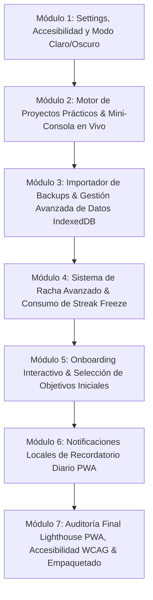

# 🏗️ Nodu — Plan Maestro de Desarrollo Modular (EXECUTION_PLAN)

> **Documento de Control y Secuencia de Desarrollo**  
> **Filosofía:** Desarrollo atómico e incremental. Cada módulo se completa con:
> 1. Código TypeScript / React limpio y tipado.
> 2. Verificación de tests automáticos (`npm test`) y compilación de producción (`npm run build`).
> 3. Documentación técnica estilo Obsidian en `docs/` vinculada a `docs/INDEX.md`.
> 4. Commit atómico en Git bajo la convención *Conventional Commits*.

---

## 🗺️ Mapa de Fases y Módulos de Desarrollo

---

## 📋 Detalle de Cada Módulo

### 🔹 Módulo 1: Configuración, Accesibilidad y Motor de Temas (Settings & Theming)
- **Objetivo:** Permitir al usuario personalizar su experiencia y necesidades de accesibilidad.
- **Entregables:**
  - Componente `SettingsModal.tsx` accesible desde el perfil o cabecera.
  - Alternador de tema: **Oscuro OLED** (`#0e131f`) vs. **Claro Cristal** (`#f8fafc`).
  - Control de efectos sonoros (`soundFX.toggleMute()`).
  - Opciones de accesibilidad: tamaño de fuente aumentado y respeto a `prefers-reduced-motion`.
- **Verificación:** Persistencia de preferencias en Dexie.js (`profile.settings`).

---

### 🔹 Módulo 2: Motor de Proyectos Prácticos & Mini-Consola en Vivo (Project Runner)
- **Objetivo:** Brindar al estudiante la experiencia de programar código libre en proyectos integradores (como el *Mini-Cifrador César* de Python).
- **Entregables:**
  - Componente `ProjectRunnerModal.tsx`.
  - Mini-editor con teclado de sintaxis táctil (`:`, `Tab`, `[]`, `{}`).
  - Consola de salida de texto en tiempo real.
  - Validador contra batería de casos de prueba (`expectedOutput` / tests unitarios locales).
  - Emisión del certificado al completar el proyecto.
- **Verificación:** Tests unitarios del validador de proyectos y feedback de éxito/error.

---

### 🔹 Módulo 3: Importador de Backups & Resiliencia de Datos (Data Resilience)
- **Objetivo:** Garantizar la portabilidad total y la recuperación ante fallos de la base de datos local.
- **Entregables:**
  - Componente / Modal de Importación de JSON con validación de esquema en tiempo de carga.
  - Confirmación atómica previa antes de sobrescribir datos.
  - Botón de limpieza segura de datos de prueba (*Reset Local Data*).
- **Verificación:** Prueba de ciclo completo: Exportar $\rightarrow$ Reset $\rightarrow$ Importar $\rightarrow$ Validar persistencia intacta.

---

### 🔹 Módulo 4: Sistema de Racha Avanzado & Consumo de Streak Freeze (Habit Engine)
- **Objetivo:** Proteger la motivación intrínseca del estudiante sin penalizaciones frustrantes.
- **Entregables:**
  - Algoritmo de control de fecha local (comparación `lastActiveDate` vs `today`).
  - Detección de día saltado y consumo automático del *Streak Freeze* (Congelador de Racha) para mantener la racha activa.
  - Notificación visual de advertencia suave: *"Tu racha fue salvada por un congelador de racha"*.
  - Tienda de créditos/gemas para adquirir nuevos congeladores.
- **Verificación:** Tests con fechas simuladas de ayer y anteayer.

---

### 🔹 Módulo 5: Onboarding Interactivo & Diagnóstico de Nivel (First-Run Experience)
- **Objetivo:** Ofrecer una bienvenida acogedora de 10 segundos que configure el objetivo diario sin fricción.
- **Entregables:**
  - Componente `OnboardingFlow.tsx` mostrado únicamente en el primer inicio de la app.
  - 3 diapositivas explicativas interactivas.
  - Selección de meta diaria: Casual (5 min), Regular (10 min), Intensivo (20 min).
  - Selección de nivel: *"Comenzar desde cero"* vs *"Test de nivel rápido"*.
- **Verificación:** Chequeo en `db.profile` del estado `hasCompletedOnboarding`.

---

### 🔹 Módulo 6: Recordatorios Diarios y PWA Offline Polish (Service Worker & Push)
- **Objetivo:** Consolidar el hábito diario con recordatorios sutiles y offline robusto.
- **Entregables:**
  - Configuración de la hora de recordatorio diario en Ajustes (ej. 20:00h).
  - Integración con Notifications API local (sin servidores de push remotos).
  - Manifest PWA con iconos 192x192 y 512x512 para instalación en móvil o escritorio.
- **Verificación:** Auditoría de registro y actualización del Service Worker.

---

### 🔹 Módulo 7: Auditoría Final de Calidad, Rendimiento & WCAG AA (QA & Polish)
- **Objetivo:** Garantizar excelencia de nivel producción en todos los frentes.
- **Entregables:**
  - Revisión exhaustiva de contraste de colores (contrast ratio $\ge 4.5:1$).
  - Navegación completa por teclado (foco visible, teclas de acceso rápido `1-4`, `Enter`, `Esc`).
  - Optimización de chunks y bundles de Vite para tiempo de carga instantáneo.
- **Verificación:** `npm test` al 100%, `npm run build` sin advertencias de tamaño y `QA_PLAN.md` verificado.

---

## 🚦 Estado de Aprobación y Arranque

¿Apruebas este orden de desarrollo modular? Si estás de acuerdo, arrancamos de inmediato con el **Módulo 1: Configuración, Accesibilidad y Motor de Temas (Settings & Theming)**.
