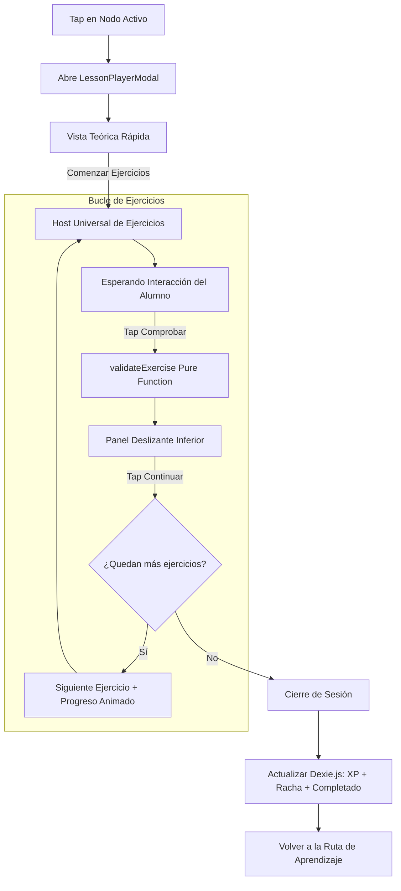

# 🎮 Arquitectura del Reproductor de Lecciones (LESSON_PLAYER)

> **Documento de Arquitectura de Componentes** | Tipo: Component Spec  
> **Ubicación:** `src/components/LessonPlayerModal.tsx` & `src/components/exercises/`  
> **Conexiones:** [[LEARNING_ENGINE]], [[COURSE_SCHEMA]], [[DESIGN_SYSTEM]], [[OFFLINE_STORAGE]]

---

## 1. Responsabilidad del Módulo

El **Lesson Player** es el componente orquestador que gestiona el ciclo de vida de una sesión de estudio interactiva de 3 a 5 minutos:

1. **Fase 1: Introducción Atómica (`isIntroStage`):**
   - Presenta un titular conceptual directo, un resumen sintético ($<30$ segundos de lectura) y un bloque de código ilustrativo.
2. **Fase 2: Motor Polimórfico de Ejercicios (`ExerciseUniversalHost`):**
   - Monta dinámicamente el componente de interfaz adecuado (`MultipleChoice`, `TrueFalse`, `FillBlank`, `ParsonsOrder`, `SpotBug`, `PredictOutput`) según el tipo de datos declarado en el `CourseSchema`.
3. **Fase 3: Evaluación y Feedback Constructivo:**
   - Valida la respuesta en cliente de forma síncrona mediante `validateExercise()`.
   - Muestra el panel deslizante inferior con retroalimentación inmediata: esmeralda para refuerzo positivo y coral para pistas pedagógicas.
4. **Fase 4: Consolidación y Persistencia Local:**
   - Acumula los puntos de experiencia (XP) y actualiza la base de datos `IndexedDB` a través de Zustand y `Dexie.js`.

---

## 2. Diagrama de Flujo del Reproductor

---

## 3. Componentes Especializados Conectados

- **`ExerciseUniversalHost.tsx`**: Fachada polimórfica que abstrae el renderizado según `exercise.type`.
- **`MultipleChoiceRenderer.tsx`**: Opciones con micro-relieve táctil y teclas rápidas numéricas.
- **`TrueFalseRenderer.tsx`**: Cuadrícula de decisión binaria con estados cromáticos definidos.
- **`FillBlankRenderer.tsx`**: Vista de código con ranura interactiva y barra de tokens contextuales.
- **`ParsonsOrderRenderer.tsx`**: Ensamblador de bloques arrastrables y seleccionables con tap para aprender secuenciación.
- **`SpotBugRenderer.tsx`**: Selector táctil de líneas de código para depuración visual.
- **`PredictOutputRenderer.tsx`**: Bloque de terminal y deducción de consola.
